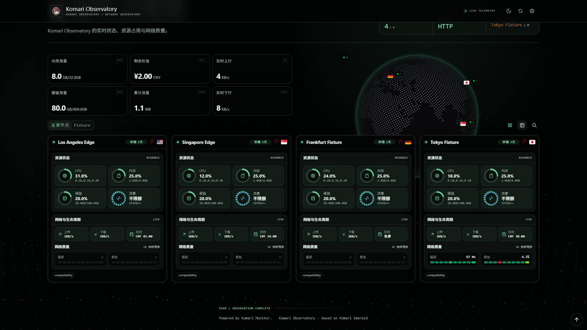

# Komari Observatory

<p align="center">
  <a href="https://raw.githubusercontent.com/LeonR-92/komari-theme-leonetlab/main/docs/preview.png">
    
  </a>
</p>

A responsive observatory theme for [Komari](https://github.com/komari-monitor/komari), derived from [Komari Emerald](https://github.com/Tokinx/komari-theme-emerald). It combines live node telemetry, a draggable COBE globe, Ping analytics, adaptive card and list views, light/dark modes, and browser-managed PWA installation.

Version: `1.6.1` · Primary target: Komari `1.6.1`

## Features

- Responsive node cards and lists with resources, traffic, uptime, billing, expiry, and Ping quality
- Draggable COBE globe, regional telemetry, detailed charts, compact Ping probe controls, and optional GPU/process/network metrics
- First-visit globe handoff, visitor scan, search reordering, and circular appearance transitions
- Eight light/dark color palettes, selectable native/halo cursor, and persistent monthly/quarterly/yearly billing display
- Managed branding and display settings, keyboard/touch support, reduced motion, and conflict-free PWA manifest/icon integration
- Legacy `Client[]` and modern UUID-keyed node response compatibility

## Installation

In **Komari → Settings → Theme management**, add this repository:

```text
https://github.com/LeonR-92/komari-theme-leonetlab
```

Komari resolves the latest public GitHub Release automatically. Alternatively, upload `komari-theme-leonetlab-build-v1.6.1.zip` directly, then select **Komari Observatory**.

## Configuration and privacy

All options are available through Komari managed theme settings. Blank branding fields inherit the Komari site configuration.

Theme settings are public. Never place passwords, API keys, node tokens, private endpoints, or personal data in them. The optional visitor panel uses public IP-geolocation providers; disable it when that lookup is not appropriate. Installation remains browser-controlled through the manifest. The theme does not register a Service Worker or cache pages, assets, RPC, API, WebSocket, visitor, exchange-rate, Ping-history, telemetry, or user data; the bundled migration worker only retires explicitly named legacy theme caches for existing installations.

## Compatibility

- Primary: Komari `1.6.1`
- Regression coverage: `1.2.5-fix1`, `1.2.5-fix2`, `1.2.6`, `1.2.7`, `1.3.2`, `1.4.2`, `1.4.3`, `1.5.0/fix1`, `1.5.1`, and `1.6.0`
- `src/utils/nodeResponse.ts` normalizes legacy arrays and UUID-keyed objects
- Modern Ping methods use a controlled `common:getRecords` fallback only for documented compatibility failures
- Optional per-device GPU charts align samples by timestamp. When the metric API cannot supply data, supported servers can provide up to four hours of GPU records via `public:getRecordsByUUID`.

Future upgrades follow the public read-only API and capability responses. Test builds use `target-version-beta.N`; optional metrics stay capability-gated, while Agent credentials, notification administration and removed visitor-audit methods are outside the theme.

## Development

```powershell
npm ci
npm run lint
npm run build
npm run validate
npm run smoke:1.6.1
```

The production build creates `komari-theme-leonetlab-build-v1.6.1.zip` with only the root manifest, root preview, and compiled `dist/` tree. During maintenance, use focused tests for affected behavior rather than repeating every fixture and browser after each edit.

## Theme Market

- Unique short name: `LeoNetLab` (retained for existing market update compatibility)
- Preview: `https://raw.githubusercontent.com/LeonR-92/komari-theme-leonetlab/main/docs/preview.png`
- Package: the single ZIP asset attached to the latest Release

## Credits

Komari Observatory retains the original MIT attribution for Tokinx's [Komari Emerald](https://github.com/Tokinx/komari-theme-emerald). It also uses [Vue](https://vuejs.org/), [Vite](https://vite.dev/), [COBE](https://cobe.vercel.app/), and [ECharts](https://echarts.apache.org/).

Released under the [MIT License](LICENSE). Copyright © 2026 LeoNetLab ([LeonR-92](https://github.com/LeonR-92)).
